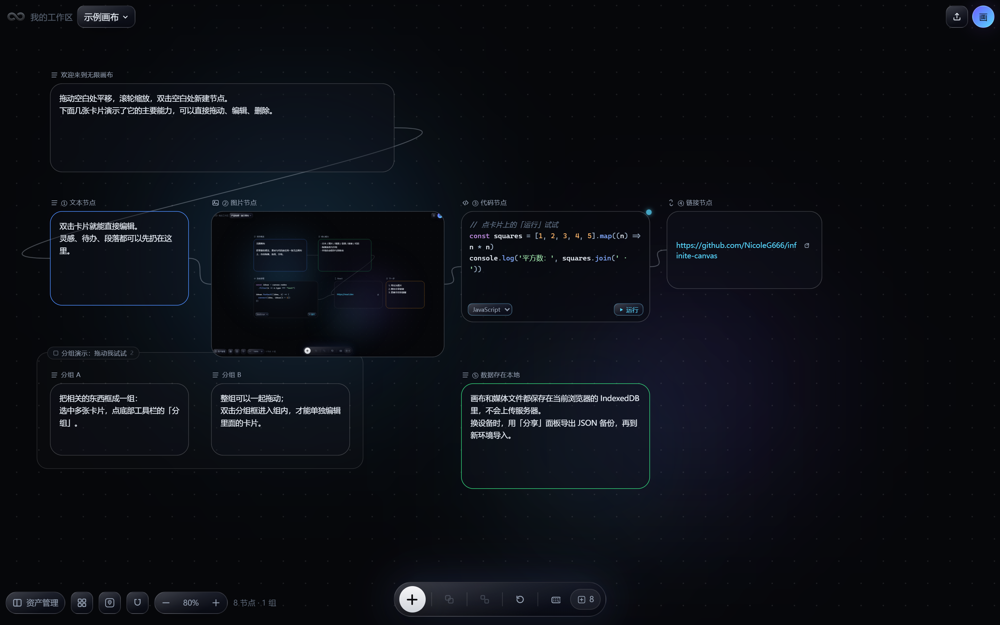

# 无限画布 Infinite Canvas

一个**本地优先**的无限画布笔记工具：把文字、图片、视频、音频、链接和代码放到一块可以无限平移、缩放的画布上，用连线和分组理清关系。无需注册，打开即用，数据保存在你自己的浏览器里。

[**在线体验**](https://37jg3fszh5ayb212c06.traesite.cn) · [**产品介绍**](https://37jg3fszh5ayb212c06.traesite.cn/demo.html) · [**GitHub 仓库**](https://github.com/NicoleG666/infinite-canvas) · [本地运行](#本地运行) · [数据存在哪里](#数据存在哪里)



## 核心功能

- **无限画布**：平移、以鼠标为中心缩放（0.1x – 4x）、点状网格背景。
- **六类节点**：文本、图片、视频、音频、链接、代码块，媒体按真实宽高比展示。
- **连线与分组**：从节点锚点拖出连线，支持选中、删除；多选节点可成组、整组拖动、进入组内编辑。
- **磁吸加号**：鼠标靠近节点时出现加号，点击即可从锚点拉出连线。
- **整理画布**：按连线关系一键排成从左到右的脑图结构，自动缩放居中。
- **多画布文档**：一个工作区可建多张画布，支持切换、重命名、复制、导出。
- **资产库**：笔记级素材（跨画布共享），可上传、分类、移动、删除。
- **本地持久化**：IndexedDB 自动保存（700ms 防抖），关页前自动落盘。
- **数据安全**：多标签页写入冲突保护、删除进回收站（30 天可恢复）、JSON 备份导入导出、崩溃兜底与本地错误记录。

## 在线体验

<https://37jg3fszh5ayb212c06.traesite.cn>

打开后会自动创建一块空白画布，点击底部中间的 **+** 添加节点即可开始。首次访问还会自动生成一块「示例画布」，用文本、图片、代码、链接节点和分组把主要能力演示一遍；想随时回到它，可以打开 <https://37jg3fszh5ayb212c06.traesite.cn/?demo=1>。

如果你想先看「这个工具是干什么的」，可以打开[产品介绍页](https://37jg3fszh5ayb212c06.traesite.cn/demo.html)，那里用一屏把核心用法、节点类型和数据存放位置讲清楚。

## 本地运行

要求 Node.js 18+。

```bash
npm install
npm run dev        # 开发模式，默认 http://localhost:5173
```

生产构建与本地预览：

```bash
npm run build      # 类型检查 + 构建，输出 dist/
npm run preview    # 预览构建产物
```

常用检查：

```bash
npm run typecheck  # TypeScript 类型检查
npm run verify     # typecheck + build
```

## 数据存在哪里

- 所有画布、资产和图片都保存在**当前浏览器**的 IndexedDB 中（数据库名 `infinite-canvas-notes`），不会上传到任何服务器。
- **换设备、换浏览器或清理浏览器数据后，画布不会自动出现**。需要迁移时，请在「分享」面板使用「备份全部画布」导出 JSON，再到新环境用「导入 JSON」恢复。
- 注意：JSON 备份包含画布结构与文本内容，**不包含图片/视频/音频文件本身**；媒体文件仍只留在原浏览器的 IndexedDB 中。
- 多标签页同时编辑同一画布时，后写入的一方会被提示冲突，不会静默覆盖。

## 技术栈

React 18 · TypeScript · Vite · Zustand · Konva / react-konva · IndexedDB（自封装）· Prism.js · Skulpt

## License

[MIT](LICENSE) © 2026 知鹿
